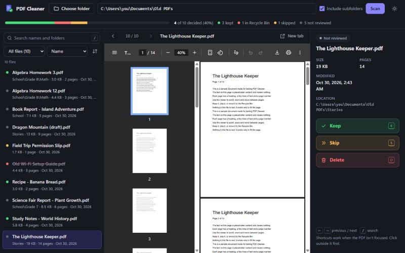
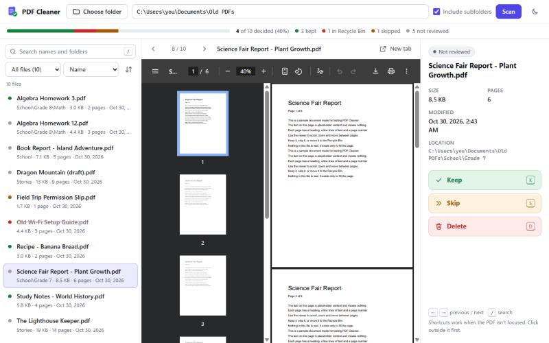
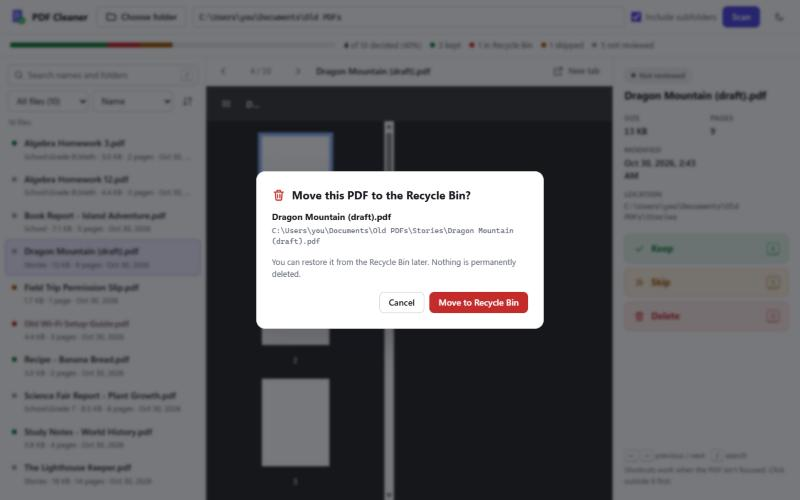
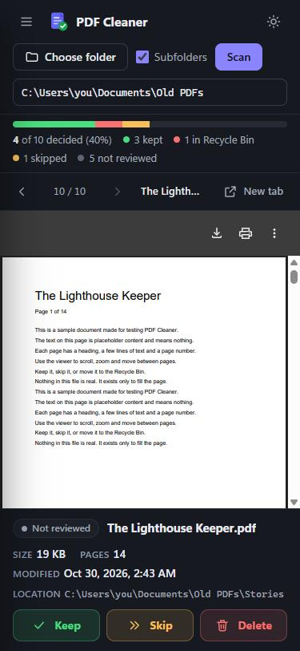

# PDF Cleaner

**Review the PDFs on your Windows computer one at a time, find duplicates, and decide what to keep.**

PDF Cleaner is a small, free app that finds every PDF in a folder you choose, shows them to you one by one, and lets you **Keep**, **Skip**, or **Delete** each one. It can also find **duplicate PDFs** (files with exactly the same contents, whatever they're called) and show you **where any file is** in File Explorer. It runs entirely on your own computer: nothing is uploaded, and nothing is ever permanently erased. **Delete always moves the file to the Windows Recycle Bin**, so you can restore it later.

Starting with version 1.1.0 it comes as a single **`PDFCleaner.exe`**. Download it and double-click it. You don't need to install Python or anything else.



---

## Contents

- [Features](#features)
- [Screenshots](#screenshots)
- [Privacy and safety](#privacy-and-safety)
- [Supported systems](#supported-systems)
- [Install and run](#install-and-run)
- [How to use it](#how-to-use-it)
- [Finding duplicates](#finding-duplicates)
- [Where your progress is saved](#where-your-progress-is-saved)
- [Troubleshooting](#troubleshooting)
- [For developers](#for-developers)
- [License](#license)

## Features

- **One PDF at a time.** A built-in viewer lets you scroll, zoom, change pages and read the whole document.
- **Clear details.** File name, size, page count, folder location and last-modified date.
- **Three simple choices:**
  - **Keep**: marks the file as reviewed. The file isn't changed.
  - **Skip**: leaves the file alone and moves on. You can come back later.
  - **Delete**: asks you to confirm, then **moves the file to the Windows Recycle Bin**. It is never permanently erased.
- **Find duplicates** *(new in 1.1.0)*. Finds PDFs with exactly the same contents, even when their names are different. You choose which copies to keep, then move the extra copies to the Recycle Bin in one go. Nothing is removed until you confirm, and at least one copy of every file is always kept.
- **Show in folder** *(new in 1.1.0)*. Opens File Explorer with the file selected, so you can see exactly where it is on your computer.
- **Standalone app** *(new in 1.1.0)*. One `PDFCleaner.exe`. No Python, no installer, no admin rights.
- **Undo and change your mind.** Every Keep or Skip can be undone, and any decision can be changed later.
- **Remembers your progress.** Decisions are saved on your computer after every click, and the last folder reopens next time.
- **Search, sort and filter.** Search by file or folder name. Sort by name, date, size, pages or folder. Filter by not reviewed, kept, skipped or in Recycle Bin.
- **Subfolders.** Optionally include every folder inside the one you choose.
- **Keyboard shortcuts.** `K` keep, `S` skip, `D` delete, `U` clear decision, `O` show in folder, `←` / `→` previous / next, `/` search.
- **Dark and light mode**, and a layout that adapts from wide screens down to small windows.

## Screenshots

| Light mode | Delete always asks first |
|---|---|
|  |  |

<p align="center"></p>

*The screenshots use made-up sample PDFs (created by `tests/sample_pdfs.py`). The folder path shown was replaced with `C:\Users\you\Documents\Old PDFs` for privacy. They show version 1.0.0; 1.1.0 adds a **Find duplicates** button above the file list and a **Show in folder** button.*

## Privacy and safety

PDF Cleaner was built to be safe to point at your personal files.

| | |
|---|---|
| **Stays on your computer** | The app is a tiny web server that only listens on `127.0.0.1`, the address your computer uses to talk to itself. Other computers, even on your home network, can't connect to it. |
| **No internet, no cloud, no AI** | It makes no internet requests. Your PDFs, file names and details are never uploaded, sent to an AI service, or shared with anyone. No analytics, no tracking, no update checks. |
| **Never permanently deletes** | **Delete moves files to the Windows Recycle Bin**, the same as pressing Delete in File Explorer. You can restore them from there. Files on USB sticks or network drives, which have no Recycle Bin, are refused. If Windows can't recycle a file (for example, it's larger than the Recycle Bin allows), Windows asks you first. |
| **Always asks first** | Every delete shows a confirmation with the full file path. The default button is **Cancel**. Removing duplicates shows the full list of files that will move before anything happens. |
| **Always keeps one copy** | When removing duplicates, PDF Cleaner refuses to remove every copy of a file. Just before moving each extra copy, it checks again that the file's contents still match and that the copy you're keeping is still there. If anything changed, that file is left alone. |
| **Tells you exactly what happened** | If some files in a batch can't be moved (for example, one is open in another program), the others still go to the Recycle Bin, and PDF Cleaner lists exactly which files were moved and which were not, with the reason. |
| **Only PDFs, only in your folder** | It only ever acts on `.pdf` files inside the folder you chose. It never deletes folders or any other kind of file, and it doesn't follow shortcuts or links out of the folder. |
| **Never changes your PDFs** | PDFs are only opened for reading, including when looking for duplicates. |
| **Doesn't download online-only files** | Files that OneDrive keeps "online-only" are skipped when looking for duplicates, so nothing is downloaded behind your back. |
| **Protected from other websites** | Each time it starts, it creates a random secret key that's needed for every action. Other websites open in your browser can't see that key, so they can't control PDF Cleaner. |

## Supported systems

| | Status |
|---|---|
| **Windows 11** | ✅ Tested |
| **Windows 10** | Should work, but not yet tested |
| **macOS / Linux** | ❌ Not supported. Moving files to the Recycle Bin is Windows-only. |
| **`PDFCleaner.exe`** | 64-bit Windows. Nothing else needs to be installed. |
| **Python** (only if you run from source) | 3.9 or newer, from the python.org Windows installer. Tested with 3.9, 3.10 and 3.13. |
| **Browser** | Microsoft Edge or Google Chrome (recommended). Tested with a Chromium-based browser and Microsoft Edge 156. Firefox hasn't been tested. |

## Install and run

### Option A: the app (recommended)

1. Go to this project's **[Releases page](https://github.com/guyWhoWantsToCode/pdf-cleaner/releases)** and, under the newest version, download **`PDFCleaner.exe`**.
2. Move it somewhere you'll find it again, like your **Desktop** or **Documents** folder.
3. Double-click **`PDFCleaner.exe`**. A black window opens, then your web browser opens PDF Cleaner. **Leave the black window open** while you use the app. The first start can take a few seconds.
4. To stop it, close the black window. Your progress is already saved.

> **"Windows protected your PC"?** Windows shows this for apps downloaded from the internet that aren't from a big company with a paid code-signing certificate. Click **More info**, then **Run anyway**. You can check the download is the real one by comparing its SHA-256 checksum with the one in the release notes: in PowerShell, run `Get-FileHash PDFCleaner.exe`.
>
> Some antivirus programs are suspicious of apps packaged with PyInstaller, the free tool used to make `PDFCleaner.exe`. If yours blocks it, you can run PDF Cleaner from source instead (Option B), or build the `.exe` yourself (see [For developers](#for-developers)).

If the browser doesn't open by itself, open Edge or Chrome and go to **<http://127.0.0.1:8765>**.

### Option B: run from source with Python

<details>
<summary>Step-by-step instructions</summary>

**Step 1: Install Python (one time only)**

1. Go to **<https://www.python.org/downloads/windows/>**.
2. Under the first release listed under **Stable Releases**, click **Download Windows installer (64-bit)**.
3. Open the file you downloaded. It's usually in your **Downloads** folder.
4. **Important:** on the first screen of the installer, tick the box **"Add python.exe to PATH"** at the bottom.
5. Click **Install Now** and wait until it says **"Setup was successful"**. Then click **Close**.

> Already have Python 3.9 or newer? Skip this step.

**Step 2: Download PDF Cleaner**

1. At the top of this GitHub page, click the green **Code** button.
2. Click **Download ZIP**.
3. Open your **Downloads** folder, **right-click** the ZIP file (`pdf-cleaner-main.zip`) and choose **Extract All…**, then **Extract**.
4. Move the extracted **`pdf-cleaner-main`** folder somewhere you'll find it again, like **Documents** or the **Desktop**.

> Don't run it from inside the ZIP file.

**Step 3: Start PDF Cleaner**

1. Open the `pdf-cleaner-main` folder.
2. Double-click **`start.bat`**. On some computers it's shown as just **`start`**.
3. A black window opens, and your web browser opens PDF Cleaner. **Leave the black window open** while you use the app.

**Step 4: Stop PDF Cleaner**

Close the black window, or click it and press **Ctrl + C**. Your progress is already saved.

</details>

## How to use it

1. Click **Choose folder** and pick a folder with PDFs. You can also paste a folder path into the box and click **Scan**.
   Tick **Include subfolders** to also search every folder inside it.
2. The first PDF you haven't reviewed opens. Use the viewer's toolbar to zoom and change pages, or click **New tab** to read it full-screen.
3. Choose **Keep**, **Skip** or **Delete**. PDF Cleaner moves on to the next file automatically.
4. To see where a file is on your computer, click **Show in folder** (or press `O`). File Explorer opens with the file selected. If you don't see it, check the taskbar.
5. Watch the progress bar at the top. You can close the app at any time and continue later.

**Changing your mind**

- Right after Keep or Skip, click **Undo** in the message at the bottom of the screen.
- Later: select the file in the list and choose a different action, or click **Clear decision**.
- Deleted files are listed as **In Recycle Bin**. To get one back, open the **Recycle Bin** on your desktop, right-click the file, choose **Restore**, then click **Scan** again in PDF Cleaner.

**Keyboard shortcuts** work when the PDF itself isn't focused. If a shortcut doesn't work, click on the file list or the side panel first.

| Key | Action |
|---|---|
| `K` | Keep |
| `S` | Skip |
| `D` or `Delete` | Delete (asks first) |
| `U` | Clear decision |
| `O` | Show in folder |
| `←` `→` | Previous / next file |
| `/` | Search |

## Finding duplicates

1. Scan a folder, then click **Find duplicates** above the file list.
2. PDF Cleaner compares the files' **contents**, not their names. `Report.pdf` and `report copy (2).pdf` count as duplicates if they are byte-for-byte identical. Two files with the same name but different contents are not duplicates.
3. Each group of identical files is listed with its folder and date. PDF Cleaner suggests keeping the **oldest** copy in each group. Tick or untick **Keep** to choose for yourself, and use **View** or **Show in folder** to check a copy first. You can keep more than one copy, but you can't untick the last one.
4. Click **Move N copies to Recycle Bin**. A confirmation lists every file that will move. Nothing happens until you click **Move to Recycle Bin** there.
5. Afterwards, a report lists exactly which files were moved to the Recycle Bin and, if any couldn't be moved, which ones and why.

**How it works:** first it groups files by exact size, because files with different sizes can't be identical. Then it calculates a SHA-256 fingerprint of only the files that share a size. Files with the same size and the same fingerprint are identical. Large folders can take a while; you can click **Stop** at any time.

## Where your progress is saved

Your decisions are saved in:

```
%LOCALAPPDATA%\PDF Cleaner\progress.json
```

That's usually `C:\Users\<your name>\AppData\Local\PDF Cleaner\progress.json`. To open it, press **Win + R**, type `%LOCALAPPDATA%\PDF Cleaner` and press Enter. The file contains the names and folder paths of your PDFs, so keep it private. To start over, close the app and delete it.

**Coming from version 1.0.0?** Version 1.0.0 saved progress in a `data` folder next to `start.bat`. The first time 1.1.0 starts, it **copies** that file to the new place automatically and leaves the original where it was. This works when you run 1.1.0 from source in your old folder, or when you put `PDFCleaner.exe` in your old PDF Cleaner folder (next to `start.bat`) for its first start. Otherwise, copy `data\progress.json` to `%LOCALAPPDATA%\PDF Cleaner\` yourself before the first start. If progress already exists in the new place, nothing is copied or overwritten.

## Troubleshooting

<details>
<summary><strong>Windows or my antivirus blocks <code>PDFCleaner.exe</code></strong></summary>

- **"Windows protected your PC"**: click **More info**, then **Run anyway**. This appears because the app isn't signed with a paid certificate.
- **Antivirus warning**: apps made with PyInstaller are sometimes flagged by mistake. Compare the file's SHA-256 checksum (PowerShell: `Get-FileHash PDFCleaner.exe`) with the one in the release notes. If they match, it's the official file. You can also run from source (Option B), which needs no `.exe` at all.
- **Nothing happens when you double-click**: wait a few seconds; the first start unpacks the app. If still nothing, right-click the file → **Properties** and, if there's an **Unblock** box at the bottom, tick it and click **OK**.
</details>

<details>
<summary><strong>"PDF Cleaner needs Python 3.9 or newer, and it wasn't found"</strong> (running from source)</summary>

- This only applies to `start.bat`. `PDFCleaner.exe` doesn't need Python.
- Install Python as described in [Option B](#option-b-run-from-source-with-python), and make sure **"Add python.exe to PATH"** is ticked.
- If you installed Python without that box: run the Python installer again, choose **Modify**, then **Next**, tick **"Add Python to environment variables"**, and click **Install**.
- After installing, **close and reopen** the PDF Cleaner folder, then double-click `start.bat` again.
</details>

<details>
<summary><strong>The black window flashes and closes, or says it can't find its files</strong></summary>

- You're probably running `start.bat` from inside the ZIP. Right-click the ZIP, choose **Extract All…**, and run `start.bat` from the extracted folder.
- Make sure `server.py` and the `static` folder are next to `start.bat`.
</details>

<details>
<summary><strong>The browser doesn't open, or shows "This site can't be reached"</strong></summary>

- Check that the black PDF Cleaner window is still open. The app only works while it's running.
- Look in the black window for the exact address, for example `http://127.0.0.1:8766/`. If port 8765 was busy, it uses the next free one. Type that address into Edge or Chrome.
- If you see "PDF Cleaner was restarted. Please reload the page", press **F5**.
</details>

<details>
<summary><strong>"PDF Cleaner is already running"</strong></summary>

Only one copy can run at a time, so two copies can't overwrite each other's saved progress. Switch to the browser tab that's already open, or close the other black PDF Cleaner window (check the taskbar) and start it again.
</details>

<details>
<summary><strong>The PDF area is blank, or the PDF downloads instead of showing</strong></summary>

- Use **Microsoft Edge** or **Google Chrome**. Both have a built-in PDF viewer.
- In Chrome: go to `chrome://settings/content/pdfDocuments` and choose **Open PDFs in Chrome**.
  In Edge: go to `edge://settings/content/pdfDocuments` and turn **off** "Always download PDF files".
- Some damaged or password-protected PDFs can't be shown. You can still Keep, Skip or Delete them.
</details>

<details>
<summary><strong>"Can't read that folder" or files are missing from the list</strong></summary>

- Windows may not let your account read some folders (for example other users' folders or system folders). Choose a folder you can open in File Explorer.
- Files that OneDrive keeps "online-only" are listed, but their page count only appears when you open them, and they're skipped when looking for duplicates.
- Shortcuts and links to other folders are not followed. This is on purpose, so the app never leaves the folder you chose.
- PDF Cleaner shows up to 25,000 PDFs at a time. For more, choose a smaller folder.
</details>

<details>
<summary><strong>Delete doesn't work, or shows a Recycle Bin error</strong></summary>

- **"Removable or network drive, which has no Recycle Bin"**: USB sticks, SD cards and network drives have no Recycle Bin, so deleting there would be permanent. PDF Cleaner refuses on purpose. Copy the files to your computer first, or delete them yourself in File Explorer.
- **"It may be open in another program or read-only"**: close the PDF in any other app (Adobe Reader, Edge tabs, Word) and try again. If the file is read-only, right-click it in File Explorer → **Properties** → untick **Read-only**.
- **"Cancelled. The file couldn't go to the Recycle Bin"**: Windows warned that the file can't be recycled (often because it's larger than the Recycle Bin's size limit), and PDF Cleaner left it alone. You can raise the limit: right-click the **Recycle Bin** → **Properties** → set a larger **Custom size**.
- **"This file no longer exists"**: it was moved or deleted outside PDF Cleaner. Click **Scan** to refresh the list.
</details>

<details>
<summary><strong>Some duplicates weren't moved</strong></summary>

The report after **Move copies to Recycle Bin** lists each file that stayed in place and why:

- **"This file changed since the duplicate search"**: the file was edited or replaced after the search, so it's no longer a known duplicate. Click **Search again**.
- **"The copy you chose to keep is missing or changed"**: PDF Cleaner couldn't confirm the copy you're keeping is still there, so it left the whole group alone to be safe.
- **"These duplicate results are out of date"**: the folder was scanned again after the search. Click **Find duplicates** again.
- Recycle Bin errors are the same as for a single delete (see above).
</details>

<details>
<summary><strong>"File error" when choosing Keep or Skip</strong></summary>

PDF Cleaner saves progress in `%LOCALAPPDATA%\PDF Cleaner`. If that folder can't be written (for example, the disk is full), it can't save. Free up some space and try again.
</details>

<details>
<summary><strong>The "Choose folder" window or File Explorer doesn't appear</strong></summary>

It may have opened behind your browser. Check the taskbar. For **Choose folder**, you can also paste the folder path into the box and click **Scan**. To copy a folder's path, open it in File Explorer, click the address bar, and copy.
</details>

## For developers

The app itself is plain Python 3 (standard library only) plus plain HTML, CSS and JavaScript, with no runtime dependencies. PyInstaller is used only to package `PDFCleaner.exe`.

```
server.py              local web server: scanning, page counts, duplicates, Recycle Bin, saved progress
static/                the interface (index.html, app.css, app.js, theme.js, icon.svg)
start.bat              Windows launcher for running from source
build_exe.py           builds dist/PDFCleaner.exe with PyInstaller
requirements-build.txt pinned build tools (only for building the .exe)
tests/test_server.py   automated tests for v1.0 features (unittest)
tests/test_v110.py     automated tests for duplicates, Show in folder, data folder, and the .exe
tests/sample_pdfs.py   generates made-up PDFs for tests and screenshots
CHANGELOG.md           what changed in each version
```

Run it from a terminal:

```bash
py -3 server.py
```

Options: `--port 9000` picks another port, `--no-browser` stops it opening the browser, and `--version` prints the version. Set `PDF_CLEANER_DATA_DIR` to keep saved progress somewhere other than `%LOCALAPPDATA%\PDF Cleaner`.

Run the tests:

```bash
py -3 -m unittest discover -s tests -v
```

The tests work in temporary folders and never touch your files or your saved progress. Moving files to the Recycle Bin and opening File Explorer are faked. Two tests really move a small generated PDF to your Recycle Bin, so they only run when you set `PDF_CLEANER_TEST_RECYCLE=1`.

Build the `.exe`:

```bash
py -3 -m venv .venv
.venv\Scripts\python -m pip install -r requirements-build.txt
.venv\Scripts\python build_exe.py
```

This creates `dist\PDFCleaner.exe` and prints its SHA-256 checksum. Only `server.py` and the five files in `static/` go into it. To test the built `.exe` (with Python hidden from it):

```bash
set PDF_CLEANER_TEST_EXE=dist\PDFCleaner.exe
py -3 -m unittest tests.test_v110 -v
```

See [CONTRIBUTING.md](CONTRIBUTING.md) for how to help, and [SECURITY.md](SECURITY.md) to report a security problem.

## License

[MIT](LICENSE). Free to use, change and share.
